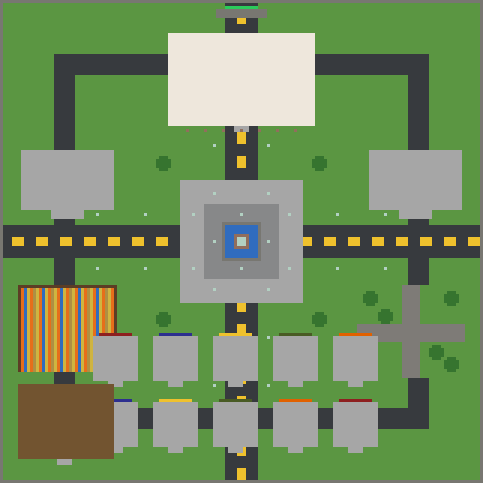

# 현실 경제 야생 스폰 v1

10명 안팎의 Paper 경제 야생 서버를 위한 현대 소도시형 WorldEdit 스키매틱입니다.

## 구성

- 중앙광장과 분수
- 시청
- 은행
- 직업 안내소
- 유저 상점 10칸
- 초보 농장과 창고
- 공원과 확장 부지
- 야생으로 이어지는 북문
- 도로, 가로등, 가로수

전체 크기는 `161 × 32 × 161` 블록이며, 붙여넣기 원점은 중앙 지면입니다.



## 배치도

```text
                         북쪽 야생
                         [북문]
                            │
                     ┌──── 시청 ────┐
                     │               │
       은행 ─────────┼── 중앙광장 ───┼──────── 직업소
                     │     분수      │
                     │               │
       초보 농장      │               │       공원
       + 창고         │               │    + 확장 부지
                     │               │
             [상점 1~5]       [상점 6~10]
                            │
                         남쪽 도로
```

## 설치

자세한 과정은 배포 폴더의 `설치안내.txt`를 확인하세요. 월드 전체를 교체하는 파일이 아니라 원하는 위치에 붙여넣는 `.schem` 파일입니다.

## 다시 생성

외부 패키지 없이 Python 3으로 생성할 수 있습니다.

```bash
python3 generate_spawn.py
```

결과는 `dist/economy_spawn_v1.schem`에 생성됩니다.
같은 폴더에 위에서 내려다본 배치도 PNG와 구조 검증 결과도 생성됩니다.
